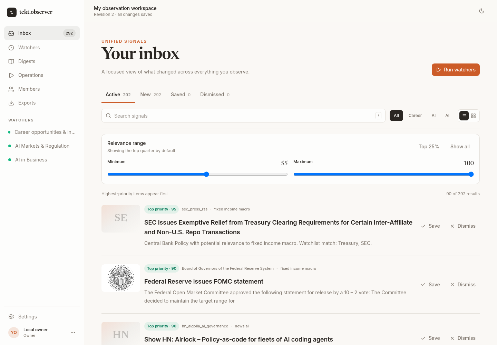
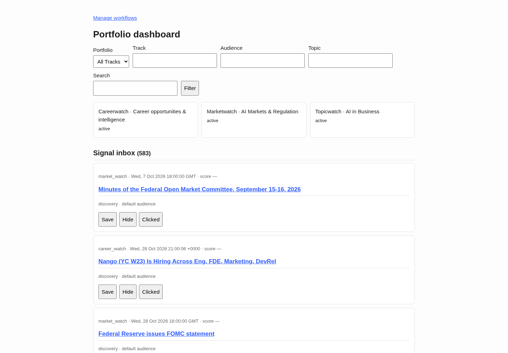
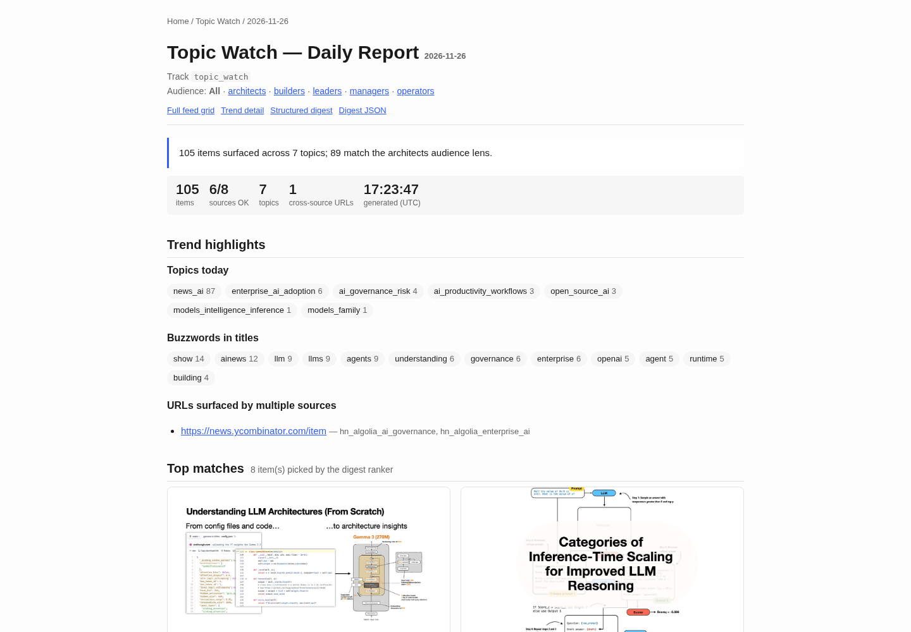
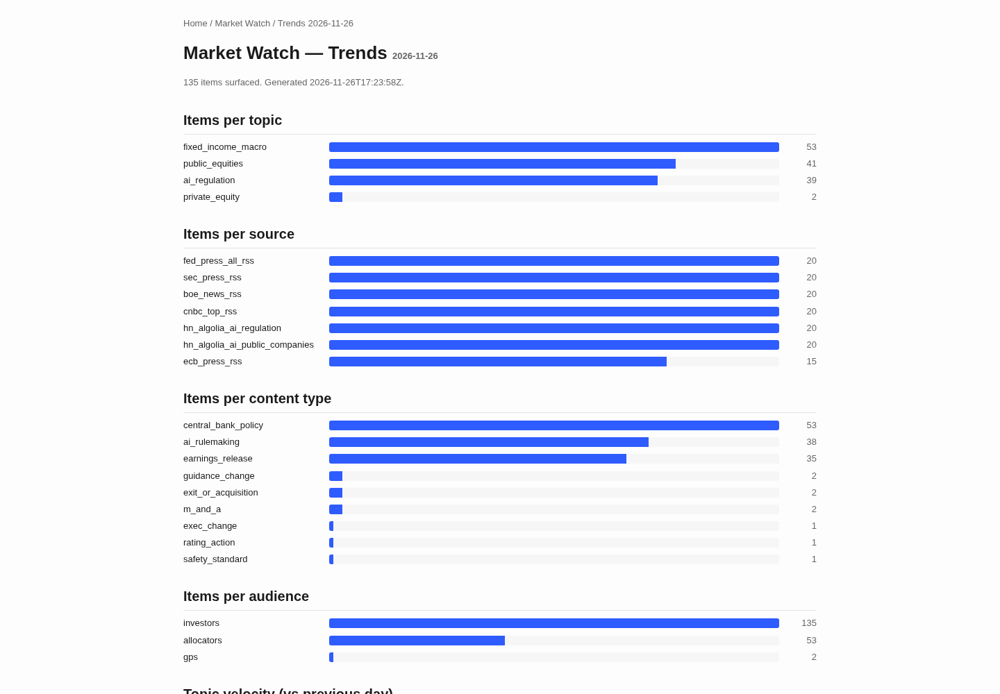
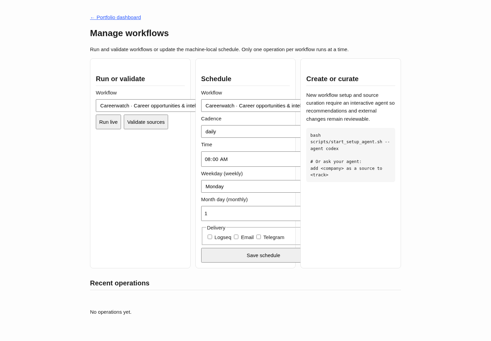

# 04 — Interface

tekt.observer has **three interface surfaces** that do not share code:

1. **React workspace app** (`frontend/`, served by `scripts/app_server.py` on 8091; Vite dev on 4173). This is the forward-looking UI.
2. **Legacy server-rendered viewer** (`scripts/serve_html.py` + `html_viewer.py`, port 8765), plus its static exports (`render_html.py`, `render_multitrack_site.py`).
3. **Outbound digests**: email (`digest_email.py`), Telegram and Logseq.

Tokens and fonts for the first two are in [00 brand](./00-arkitype.md). API routes are in [03](./03-software.md). Screenshots in `assets/` were captured on 2026-11-26 from a local run of commit `42534a5` (live pipeline output ingested with `/api/v1/runs/ingest`).

## React workspace app



```yaml
react_app:
  verified: observed            # ran app_server + built frontend, captured Inbox; other views exercised by clicking
  stack: {react: 19, data: "@tanstack/react-query", css: "Tailwind + HSL CSS variables", icons: lucide-react, util: "clsx + tailwind-merge (cn)"}
  source_size: "App.tsx 118 lines (all views in one file), api.ts, types.ts, demo-data.ts, lib.ts, styles.css; 1 test (App.test.tsx)"
  data_contract:
    load: "GET /api/v1/workspace -> WorkspaceState {workspace{id,name,revision}, watchers[], sources[], items[] (Signal), operations[], digests[], exports[]}"
    polling: "refetch every 3000 ms only while any operation is queued|running"
    demo_fallback: "on fetch error render demoState (3 watchers, sample signals); header status says 'Starter workspace · local API is starting'; mutations reject with 'Start the local app first' (Run) / resolve no-op (digest)"
    mutations: {item_status: "PATCH /api/v1/items/:id {status new|saved|dismissed}", watcher_toggle: "PATCH /api/v1/watchers/:id {enabled}", run: "POST /api/v1/runs", ingest: "POST /api/v1/runs/ingest", digest: "POST /api/v1/digests", export: "POST /api/v1/exports -> {downloadUrl} then navigate", import_validate: "POST /api/v1/imports/validate (validate only; no import apply)"}
    types:
      Watcher: {id, slug, name, description, enabled, status: "healthy|attention|paused", sourceCount}
      Signal: {id, watcher, title, description, url, topic, score: "0-100", status: "new|saved|dismissed", observedAt, provenance: "[str]", "image?", "siteName?", "author?"}
      Source: {id, watcher, name, url, discoveryMode, cadence, status: "ready|attention|failed"}
      Operation: {id, label, status: "queued|running|complete|failed", progress, updatedAt}
      Digest: {id, title, summary, createdAt, itemIds, status: ready}
      ExportRecord: {id, filename, createdAt, workspaceRevision, sha256}
  shell:
    layout: "lg: 244px sidebar + fluid main; mobile: drawer opened by the 'Open navigation' button"
    sidebar: "brand mark; nav Inbox (badge = count of status new) / Watchers / Digests / Operations / Members / Exports; WATCHERS list with status dots (emerald healthy, amber attention, slate paused) linking to Watchers; Settings; 'Local owner · Owner' footer"
    header: "sticky; workspace name; aria-live status 'Revision N · all changes saved'; theme toggle"
    persistence: "localStorage keys tekt-theme, tekt-layout, tekt-score-min, tekt-score-max"
    keyboard: {"/": "focus #signal-search (unless typing in an input)", Escape: "close detail drawer and mobile nav"}
  views:
    inbox:
      copy: {eyebrow: "UNIFIED SIGNALS", title: "Your inbox", lede: "A focused view of what changed across everything you observe.", primary: "Run watchers (-> 'Watchers running…')"}
      status_tabs: "Active (everything not dismissed) · New · Saved · Dismissed, each with count"
      filters: "search over title+description+topic; watcher chips 'All' + one per watcher; list/grid toggle"
      relevance_range: "two sliders Minimum/Maximum; default minimum = 75th-percentile score of the current candidate set ('Showing the top quarter by default'); buttons 'Top 25%' (reset to suggested) and 'Show all'; custom -> 'Using your custom score range'"
      sort: "score desc, then observedAt desc ('Highest-priority items appear first'; 'N of M results')"
      card: "thumbnail (og image or initials tile); priority pill Top priority (>=80) / Worth review (>=60) / Low confidence, plus score; source id; topic; title; description; Save / Dismiss"
      empty: "'Nothing here' / 'Try another watcher or search.'"
    detail_drawer: "'Signal detail'; Match score N/100; Status; 'Why you are seeing this' = numbered provenance lines; Save / Dismiss / Restore to inbox; 'Open source' link"
    watchers: "eyebrow Configuration; 'Questions that keep observing, even when you are away.'; card per watcher with status, sourceCount, its sources (discoveryMode, cadence, status); Pause/Enable toggle"
    digests: "eyebrow Synthesis; 'Readable summaries of the strongest active signals.'; Generate digest; empty 'No digests yet'; digest cards open item detail"
    operations: "eyebrow Activity; 'Runs, imports, exports, and maintenance in one place.'; operation rows with status and progress"
    members: "eyebrow Access; placeholder: 'Local mode has one implicit owner. Hosted collaboration is enabled through PocketBase authentication.' (no member management exists)"
    exports: "eyebrow Portability; create a deterministic hash-verified bundle (download), 'Validate import' file picker (json) showing bundleId/revision/schemaVersion/counts or 'Import validation failed: …'; list of past exports with revision + sha256"
    settings: "'Workspace settings': Dark theme toggle; informational 'Immutable JSON storage' (fsync, compaction every 100 events or 300 s) and 'Local connection · Loopback only · journal-first durability enabled'"
  accessibility: ["'Skip to content' link targeting #main-content", "aria-labels on icon buttons and regions (Workspace nav, Inbox status, Inbox layout, Minimum/Maximum score)", "role=status aria-live=polite revision line", "styles.css: :focus-visible outline 2px solid accent, offset 2px on button/input/a"]
  defects_observed:
    - "Watcher chips use the first word of the watcher name (name.split(' ')[0]): 'AI Markets & Regulation' and 'AI in Business' both render as 'AI' (visible in inbox.png). Use slug-based or full short labels."
    - "Provenance lines are internal rationale strings (e.g. 'Watchlist match: Treasury, SEC'), not user-facing explanations."
    - "UI speaks only to app_server's local JSON API. The pocketbase JS SDK (^0.26.2) is in package.json dependencies but is never imported in src/ (see 01 Mode H)."
    - "Import is validate-only; there is no apply-import route or UI."
```

## Design system

```yaml
design_system:
  verified: static-analysis   # from styles.css + tailwind config; visually consistent with assets/inbox.png
  tokens: "consumed from SITE_PROFILE.brand (00): react_app.tokens_hsl via CSS variables --canvas/--surface/--ink/--muted/--line/--accent; legacy_viewer.tokens as plain CSS custom properties"
  theme: "class 'dark' on <html>; React app persists the choice in localStorage; the legacy viewer follows prefers-color-scheme"
  type: "sans for UI, serif display for H1 page titles (4xl, semibold); eyebrow labels xs uppercase tracking .16em in accent"
  components: "Button variants default/quiet/accent; rounded-lg chips; rounded-xl bordered surfaces with shadow_soft; priority pills (emerald top / amber review / slate low)"
  rule: "two separate systems (React app vs legacy viewer) share no CSS; the rebuild should keep only the React token set"
```

## Legacy viewer (serve_html, port 8765)

| | |
|---|---|
|  |  |
|  |  |

```yaml
legacy_viewer:
  verified: observed
  routes:
    "/": "Portfolio dashboard: track-health cards per track, toolbar filter form, link 'Manage workflows'"
    "/manage": "interests/portfolios management + operations (POST forms carry csrf_token)"
    "/track/<track>": "track landing with dates"
    "/track/<track>/<date>[?audience=]": "daily report: executive summary, topic sections with counts (observed news_ai 87/105), per-audience variants"
    "/track/<track>/<date>/audience/<audience>": "per-audience report variant (path form)"
    "/track/<track>/feed/<date>": "social-feed card grid"
    "/track/<track>/trends/<date>": "trend charts + keyword cloud"
    "/track/<track>/<date>/details": "structured digest tables"
    "/track/<track>/sources": "sources + persona"
    "/track/<track>/ranked": "ranked overview (job tracks)"
    "/raw/<digests|discovery>/<track>/<date>.json": "raw JSON behind a page (404 for unknown kinds or bad paths)"
    "/api/v1/{state,interests,portfolios,items,operations,operations/<id>,tracks/<id>,tracks/<id>/taxonomy}": "JSON reads; items filter by track,q,audience,topic,date_from,date_to,interest; POST feedback/interests/portfolios/operations, operations/<id>/cancel"
  static_exports:
    render_html: "single-track static site, root-anchored URLs rewritten to relative by depth"
    render_multitrack_site:
      layout: ["<out>/index.html (tracks x dates grid)", "<out>/style.css", "<out>/<track>/index.html", "<out>/<track>/sources.html", "<out>/<track>/<date>/{index,details,feed,trends}.html", "<out>/<track>/<date>/audience/<audience>.html", "<out>/raw/<kind>/<track>/<date>.json"]
  defects_observed:
    - "Report page shows a Hacker News item linked through another source's URL (cross-source URL bug, legacy-report.png)."
    - "Topic distribution is dominated by one bucket (news_ai 87 of 105). The keyword classifier lacks discrimination (see 03)."
```

## Outbound digests

```yaml
digests_out:
  verified: static-analysis   # dry-run paths read; nothing was sent
  email:
    renderer: digest_email.render_digest_email -> RenderedDigestEmail {subject, text body, html_body}
    subject: "'<Display name> job digest: N new role(s), top score X' or '<Display name> job digest: no new roles'"
    sections: ["Executive summary (initial run only, to avoid same-day update noise)", "Recommended actions", "New jobs (or 'No new roles found today.')", "Ranked overview (top N of M), optional ranked_overview attachment"]
    issue: "Copy is job-centric even when the track is a news/market watcher."
  telegram: "plain text subject + body split at 3900 chars into '(part i/n)' messages"
  logseq: "sync_to_logseq.sh copies digests into LOGSEQ_GRAPH_DIR (skipped when unset; local only)"
open_decisions:
  - id: one-viewer
    question: "Retire the legacy viewer or port its report/feed/trends pages into the React app?"
    recommendation: "Port report + trends into the Catalog Viewer (ROADMAP-DELTA); retire serve_html."
  - id: digest-vocabulary
    question: "Generalize digest copy (signals/items) and drive it from the watcher profile?"
    recommendation: "Yes: copy comes from SITE_PROFILE watchers[].display_name and item nouns."
```
